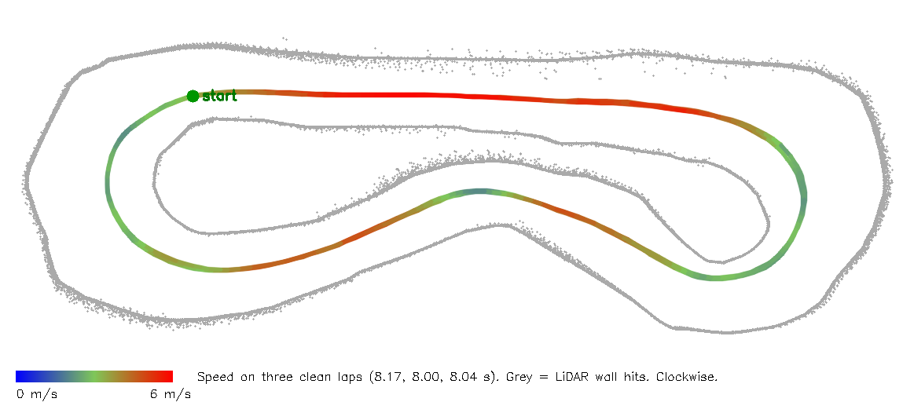

# Penn RoboRacer technical challenge

Rubi Wu, Penn M&T '30

A ROS 2 wall follower for the AutoDRIVE RoboRacer practice track (IROS 2026 release). The car steers by staying centred between the two walls. It sets its speed from a LiDAR prediction of how much free space lies along the arcs it can still drive. It starts every run slowly and only speeds up as it completes clean laps.

| Result | Value |
|---|---|
| Fastest clean lap | **7.904 s** |
| Video (Driver's Eye, unlisted) | https://youtu.be/ozXvCoFLh4Y |
| Final defaults, normal load | 30 of 30 laps clean over three fresh starts, best 7.962 s |
| Final defaults, heavy CPU load (21 to 29 Hz scans) | 44 of 45 laps clean |
| Longest clean streak | 45 laps in a row |

Lap times are the simulator's own lap clock, the same number the HUD shows. The 7.904 s lap was set with the tolerance band in place, just before latency compensation was added. The final defaults' best so far is 7.962 s.



## Video

[Unlisted YouTube video](https://youtu.be/ozXvCoFLh4Y). The car drives itself, seen from the Driver's Eye camera. The HUD on the right shows the lap count, the current lap time and the best lap. In the recorded run, with the final default settings, all 18 laps were clean. The warm-up lap took 14.3 s, the next two took 9.5 s and 8.8 s, and the best lap was 7.962 s.

## How to run

Use the setup from the challenge sheet (Docker image, bridge, practice simulator). Then, in a second terminal inside the container,

```bash
source /opt/ros/humble/setup.bash
source /home/autodrive_devkit/install/setup.bash
ros2 run autodrive_roboracer wall_follow_node
```

Switch Driving Mode to Autonomous. The first lap is deliberately slow (about 15 s), and the car reaches full speed after four clean laps. Every tunable is a ROS 2 parameter that the node reads on every scan, so it can be set at launch or changed while the car is driving.

```bash
ros2 run autodrive_roboracer wall_follow_node --ros-args -p warmup:=false
ros2 param set /wall_follow_node v_max 4.0
```

```bash
# v1, slow and steady: fixed low throttle, about 1.2 m/s, 25.9 s laps
ros2 run autodrive_roboracer wall_follow_node --ros-args -p speed_mode:=throttle
```

Stop the node with Ctrl-C. It sends throttle 0 and steering 0 before it exits, because the bridge keeps applying the last command it received.

## How it works

### Steering

This is the wall-following controller from the RoboRacer course (Lab 3). For each wall, beam b points straight at it (90 degrees) and beam a points theta degrees further forward (45 here). The node estimates the car's angle to the wall and projects the distance a lookahead L ahead.

```
alpha = atan((a*cos(theta) - b) / (a*sin(theta)))
d_t   = b * cos(alpha)
d_t1  = d_t + L * sin(alpha)
```

The practice track is only about 1.3 m wide at the start line, so the default mode follows both walls and steers to the centre, with `error = (d_t1_left - d_t1_right) / 2` and `steer = PID(error)`. Following one wall at a fixed distance is still available with `side:=left` or `side:=right`. The lookahead grows with speed (`L = 0.6 + 0.25 * v`).

Two details keep the wheels calm on the straights. Errors within a 5 cm tolerance band count as zero, so the car stops correcting once it is close enough to the centre. Outside the band the error is reduced by 5 cm, so the steering does not jump at the edge. The derivative term also treats any gap between scans shorter than 10 ms as 10 ms, because scans sometimes arrive in bursts and a 1 ms gap turned small changes into steering kicks.

### Speed from a LiDAR prediction

Every scan becomes a set of points around the car. For a fan of 21 constant-curvature arcs, from full left lock to full right lock, the node computes how far the rear axle can travel before the car's footprint (half width 0.22 m, front overhang 0.45 m) reaches one of those points. The target speed is the lowest of four limits.

| Limit | Meaning |
|---|---|
| `v_max` | a cap |
| `v_curve` | lateral acceleration `a_lat` at the current steering curvature |
| `v_free` | the speed from which the car can still stop within the free distance on the most open arc |
| `v_react` | keeps `ttc_plan` seconds of that free distance ahead |

Throttle is the target speed divided by 24.8, a gain measured in the simulator. If the car is more than 0.2 m/s above the target, throttle goes to 0, which brakes at about 3 m/s².

### Warm-up, start slow and earn speed

The car does not trust a track it has not driven yet. Every run starts in a cautious setting and moves toward the fast setting only as clean laps accumulate.

| Setting | Confidence 0 (first lap) | Confidence 1 (full speed) |
|---|---|---|
| Top speed `v_max` | 3.0 m/s | 6.0 m/s |
| Lateral acceleration `a_lat` | 4.0 m/s² | 6.0 m/s² |
| Braking assumption `a_brake` | 2.5 m/s² | 3.0 m/s² |
| Reaction margin `ttc_plan` | 0.8 s | 0.6 s |

Each clean lap adds 0.25 to the confidence, so full speed comes after four clean laps. A wall contact halves the confidence immediately, and the car has to earn the speed back. This is the additive-increase, multiplicative-decrease rule that TCP uses for congestion control. Steering is never changed by the warm-up, only how hard the car is allowed to drive. A typical fresh start runs about 15 s, then 9.3 s, 8.5 s, 8.2 s and settles near 8.0 s.

The cost is a few seconds on the first lap. What it buys is that the car's first laps on an unfamiliar track, or on a machine nobody has tuned it for, happen at 3 m/s instead of 6 m/s. The measured effect is in the results below. On its own the warm-up did not remove the contacts at very low scan rates, and that is what the latency compensation is for.

### Latency compensation

A steering or throttle command takes effect some time after the scan it was computed from, and the car keeps moving in the meantime. The node measures the average time between scans and assumes a command acts three scan intervals later (simulator to bridge to node and back). The distance the car covers in that time is added to the steering lookahead and taken off every free distance before speed is planned. At the normal 70 Hz this is about 0.2 m at 5 m/s. At 25 Hz it is about 0.6 m, so a slower machine automatically brakes and turns in earlier.

### Restraint layer and watchdog

A separate check cuts throttle only when contact can no longer be avoided, meaning even the best arc has less than `ttc_brake` (0.5 s) of room at the current speed. The planner keeps a larger margin (`ttc_plan`), so in normal driving it slows the car first and the restraint layer stays silent. The node counts every intervention, prints it in the lap report and publishes it on `/wall_follow/restraint_count`.

A 10 Hz watchdog sets throttle to 0 if no scan has arrived for 0.5 s, because the bridge would otherwise keep driving on the last command. The same timer keeps the node responsive to Ctrl-C when no data is arriving.

## Measured before tuning

A short scripted probe checked the conventions on the sheet and measured the car before any controller ran.

| Quantity | Measured |
|---|---|
| Steering command 1.0 | 0.524 rad, positive turns left |
| LiDAR | 1081 beams, +90 degrees is the car's left |
| Speed per unit throttle | about 24.8 m/s (0.05 gives 1.24 m/s, 0.12 gives 2.97 m/s) |
| Deceleration at throttle 0 | 3.0 m/s² |
| Deceleration at throttle -0.12 | 2.9 m/s², no stronger than coasting |
| Effective wheelbase | 0.34 m, from yaw rate in a measured turn |
| Track | about 29.4 m per lap, clockwise, 1.15 to 2.68 m wide |
| Scan rate | 63 to 76 Hz on an idle Mac, 21 to 29 Hz under heavy CPU load |

The throttle gain mattered most. The first draft's default throttle of 0.30 would have meant about 7.4 m/s on a 1.3 m wide track.

## Results

| Version | Best lap | Notes |
|---|---|---|
| v1, centred PID, fixed low throttle | 25.89 s | first three laps all clean |
| v2 planner, top speed 2 m/s | 15.03 s | clean |
| v2 planner, top speed 4 m/s | 10.04 s | clean |
| v2 planner, top speed up to 7 m/s | 9.13 s | at 7 m/s it touched the wall twice, and the restraint layer fired 41 to 59 times per lap |
| v2.1 escape-based planner | 8.142 s | 45 clean laps in a row while tuning |
| v2.1, 164-lap run on a busy Mac | 8.082 s | 154 clean, 12 contacts on 10 laps |
| v2.2 warm-up and 5 cm tolerance band | 7.904 s | 8 of 8 clean |
| v2.2 final defaults (adds latency compensation) | 8.002 s | 12 of 12 clean from two fresh starts |
| v2.2 final defaults, the recorded run | 7.962 s | 18 of 18 clean, warm-up lap 14.3 s |

**Heavy load.** To reproduce the conditions of the 164-lap run, 18 busy loops ran in the Docker VM, which dropped the scan rate to 21 to 29 Hz. Each fresh start was a reset, three laps and a stop.

| Under heavy load | Fresh starts, 15 laps | One 30-lap run | Total clean |
|---|---|---|---|
| Warm-up on, no latency compensation | 13 | 25 | 38 of 45 |
| Warm-up off, no latency compensation | 13 | not run | 13 of 15 |
| Warm-up and latency compensation (final) | 15 | 29 | 44 of 45 |

At normal load all fresh starts were clean with the warm-up on and off (4 each), so the warm-up cost a few seconds there and did not change the contact count. Under heavy load the warm-up alone did not help either (13 of 15 both ways). Latency compensation is what moved the result. These are small samples, so treat the 44 of 45 as strong evidence of an improvement, not as a measured failure rate.

**Steering on the straights.** Recorded over 8 laps each at normal load, counting only where the wheels were within 0.1 rad of straight.

| | No band | 5 cm band |
|---|---|---|
| Wheel motion per metre | 0.213 rad | 0.130 rad |
| Steering sign changes per metre | 1.89 | 0.59 |
| Time with the wheels exactly straight | 1% | 14% |
| Best lap | 8.213 s | 7.904 s |

Settings were tuned with a script that changes parameters on the running node, skips one transition lap and then records lap times, contacts and restraint interventions.

## Three ways to predict a collision

The RoboRacer course's Lab 2 uses instantaneous time to collision, `iTTC = r / max(-r_dot, 0)` with `r_dot = -v cos(theta)`, and asks for a brake that does not trigger falsely. On this track that is hard. At 2 m/s on the start straight, centred with 0.62 m to each wall, the minimum iTTC over the front 120 degrees was 0.61 s, because beams angled toward the side walls see them as approaching. A threshold above 0.6 s would brake the whole straight. Time to contact along the arc the car was actually driving was 3.7 s at the same moment.

The arc the car is on right now has its own problem at speed. The centring controller turns in sharply at corner entry, and that arc briefly points at a wall even though the car is about to steer away. A restraint layer based on it fired 41 to 59 times per lap at 7 m/s, and the car still touched the wall twice. Asking instead whether any reachable arc still has room (the steering servo reached its commanded angle within 0.2 s in the probe, so the whole fan is reachable within the 0.5 s threshold) removed those false interventions. The same quantity drives the planner, so the planner and the safety check agree about what is dangerous.

## Known limitation

Under heavy load one lap in 45 still touched a wall. The heavy load was emulated with busy loops in the Docker VM, which is close to but not the same as a slower computer. The samples are small, so the real contact rate under load is not pinned down.

## Problems found along the way

1. The first draft of the controller had the error sign reversed and steered into the wall it was following. A numerical check with a synthetic scan caught it before the simulator was used, and a unit test now guards it.
2. With rclpy's default signal handling, Ctrl-C shut ROS down before the node's final stop command, which then failed with "publisher's context is invalid". The bridge kept the last throttle and the car drove into a wall. The node now handles SIGINT and SIGTERM itself and sends the stop command before shutting down.
3. That fix had a gap. With no scans arriving, the node waited forever and ignored Ctrl-C. The 10 Hz watchdog timer closes it, and the car now stops within about half a second either way.
4. Closing the terminal that runs `docker exec` does not stop the node inside the container. Stop it with Ctrl-C.

## Tests

`autodrive_devkit/test/test_wall_follow.py` has 30 offline tests that need no simulator. They cover beam indexing, the wall geometry, the steering sign for both sides and centre mode, the tolerance band, the derivative floor, the throttle floor, the arc prediction, latency compensation, iTTC, the speed planner and the warm-up rule. Closed-loop tests drive a kinematic bicycle model around synthetic tracks, including ones as narrow as the practice track. From the cloned challenge repo,

```bash
docker run --platform linux/amd64 --rm -e PYTHONDONTWRITEBYTECODE=1 \
  -v "$(pwd)/autodrive_devkit":/home/autodrive_devkit/src/autodrive_devkit --entrypoint /bin/bash \
  penn-challenge -c 'source /opt/ros/humble/setup.bash && cd src/autodrive_devkit && python3 -m pytest -p no:cacheprovider test/test_wall_follow.py -q'
```

The toy car model is an approximation, so these tests check signs, geometry and stability. Lap times come only from the simulator.

## Files

`autodrive_devkit` is the package from the AutoDRIVE RoboRacer Sim Racing repository (BSD 2-Clause, see `LICENSE-AutoDRIVE`). Three files were added or changed, and `autodrive_bridge.py` is untouched.

| File | Change |
|---|---|
| `autodrive_roboracer/wall_follow_node.py` | new, the controller |
| `setup.py` | one console_scripts entry for `wall_follow_node` |
| `test/test_wall_follow.py` | new, offline tests |

Built with Claude (Anthropic) as a coding assistant, which the challenge allows.
